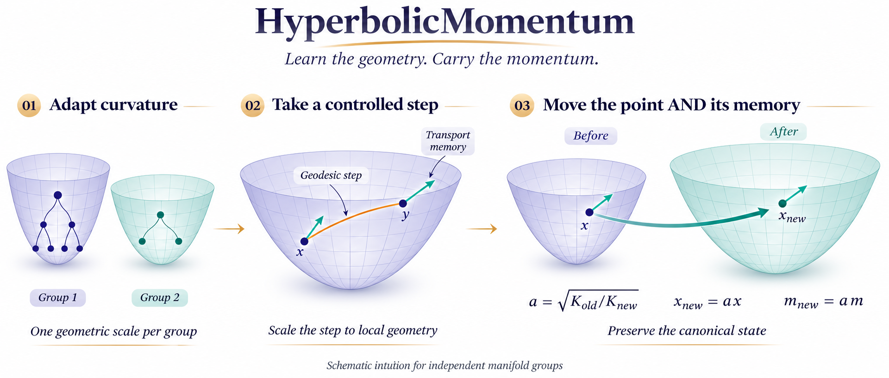

<div align="center">

# HyperbolicMomentum
### Curvature-Adaptive Manifold Optimization

[](https://github.com/Hik289/manifold-hyperbolic-optimization/actions/workflows/checks.yml)




*A conceptual illustration for independent Lorentz-manifold groups; it is not an experimental result.*

</div>

HyperbolicMomentum studies optimization when **curvature is itself a learned state**. It combines group-specific curvature, curvature-normalized geodesic steps, and a compatible map of both the parameters and their tangent momentum. This repository contains the research implementation, every experimental source file, registered configurations, completed numerical records, and the full manuscript with detailed convergence and generalization analysis.

## At a glance

| Component | Included |
| :--- | :--- |
| Geometry | Lorentz exponential/log maps, parallel transport, tangent projection, cross-curvature maps |
| Optimization | Euclidean and fixed-curvature controls, learned curvature, normalization and transport ablations |
| Experiments | Synthetic hierarchies, metric drift, node classification, text, vision, KG, recommendation and continual learning |
| Additional tasks | Taxonomy, held-out link prediction and class-invariant retrieval, with delayed test evaluation |
| Reproduction | Registered configurations, evaluation protocols and published result records |
| Paper assets | Editable LaTeX, complete theoretical appendix, tables, loss-plot code and exact plotting inputs |

## Method in one minute

For curvature magnitude $K>0$, the Lorentz model satisfies $\langle x,x\rangle_{\mathcal L}=-1/K$. Each step maintains a point **and** a momentum vector in its current tangent space.

1. **Control the geometric step.** Average tangent gradients into $\widetilde m$, then use $\eta_{\mathrm{geo}}=\eta/(1+\gamma\sqrt K\lVert\widetilde m\rVert)$.
2. **Move on the current manifold.** Apply the exponential map and parallel-transport momentum to the new base point.
3. **Adapt curvature slowly.** Take the total curvature derivative at a fixed canonical point, with bounded drift in the implementation.
4. **Map the joint state.** With $a=\sqrt{K_{\mathrm{old}}/K_{\mathrm{new}}}$, map $x\leftarrow ax$ and $m\leftarrow am$, then restore numerical tangency.

The canonical point $\sqrt Kx$ and momentum $\sqrt Km$ are preserved by this ideal joint scaling. The interpretation applies to architectures with a dedicated manifold per group; the manuscript distinguishes this setting from shared-entity models.

**Start reading:** [geometry implementation](experiments/revision/geometry.py) · [Lorentz operators](experiments/lorentz.py) · [algorithm and derivations](paper/sections/4_methodology.tex).

## Quick start

Python **3.11** is recommended. The numerical checks and small synthetic fixture run on CPU; the complete benchmark was run with CUDA. All commands below are executed from the repository root.

```bash
git clone https://github.com/Hik289/manifold-hyperbolic-optimization.git
cd manifold-hyperbolic-optimization
python3.11 -m venv .venv
source .venv/bin/activate
python -m pip install -r requirements.txt

# Check geometry, total curvature derivatives and the transport ablation.
python experiments/revision/validate_geometry.py

# A small CPU fixture; no dataset download and no benchmark claim.
python scripts/run_experiment.py --smoke --device cpu

# Audit the published final records without training or network access.
python scripts/summarize_results.py
```

The fixture writes to `artifacts/reproduction/runs/fixture_mechanism_B5/`. It is explicitly marked `fixture_only` and is separate from the registered experiments. Existing complete runs are reused; incomplete trajectories are never silently appended to.

## Run the experiments

Install the optional dataset and model dependencies for the full suite:

```bash
python -m pip install -r requirements-full.txt

# Inspect exact registered settings before launching a run.
python scripts/run_experiment.py --list --family mechanism

# Use the full registered training budget.
python scripts/run_experiment.py \
  --id mechanism_smooth8_independent_lorentz_3_B5 \
  --device cuda --work-dir artifacts/mechanism

# All retained configurations in one family, executed sequentially.
python scripts/run_experiment.py \
  --all-retained --family mechanism --device cuda
```

The entry point uses the saved manifest without changing epochs, seeds, splits or tuning rules. `--id` can also address an explicitly deferred configuration; such a new run is separate from the published completion record. Use `--data-root data` or the `MANIFOLD_DATA` environment variable to choose a dataset directory. No account-specific paths or services are required.

| Task family | Main implementation | Protocol |
| :--- | :--- | :--- |
| Synthetic hierarchies | [`structured.py`](experiments/revision/structured.py) | Tree type × size × dimension grid |
| Stationary and drifting metrics | [`mechanism.py`](experiments/revision/mechanism.py) | Matched initialization searches under stationary and drifting metrics |
| Node, text, vision and continual learning | [`runner.py`](experiments/revision/runner.py) | Full registered lengths; task-specific endpoints |
| Knowledge graphs and recommendation | [`structured.py`](experiments/revision/structured.py) | Filtered ranking and chronological recommendation splits |
| Taxonomy, link prediction, retrieval | [`new_tasks.py`](experiments/revision/new_tasks.py) | Validation-only search; test released after the complete block |
| Original exploratory studies | [`experiments/`](experiments) | Separate historical implementations and protocols |

See **[Experiment guide](docs/EXPERIMENTS.md)** for dataset layouts, baseline definitions, ablations, queue tools and evaluation commands. The observed benchmark software versions are recorded in [`requirements-reproduction.txt`](requirements-reproduction.txt); the historical exploratory scripts are not interchangeable with the revised protocol.

## Reproduce the paper and figures

No training, GPU or network access is needed to regenerate the published loss figures and comparison tables:

```bash
python paper/scripts/reproduce_figures.py
python paper/scripts/reproduce_positive_tables.py
```

The figure script reads the bundled CSV files, verifies their hashes, and writes both **PNG and PDF**. The release check reproduces the existing figure pixels in the recorded plotting environment. [`paper/scripts/requirements-figures.txt`](paper/scripts/requirements-figures.txt) records that environment; newer plotting libraries may change rendering without changing the underlying values. The new README intuition image is a conceptual illustration, with its generation specification in [`assets/intuition_prompt.txt`](assets/intuition_prompt.txt).

To compile the complete paper with TeX Live and `latexmk`:

```bash
python paper/scripts/build_paper.py
```

For Overleaf, upload the contents of `paper/`, select `main.tex`, and choose **pdfLaTeX**. The year-specific style is a **local ICML 2027 draft wrapper based on ICML 2026**, not an official 2027 release; see [template provenance](paper/TEMPLATE_PROVENANCE.txt).

## Repository map

```text
assets/                    PNG intuition figure and generation specification
experiments/               All original experiment and optimizer implementations
  revision/                Revised suite, geometry, manifests and evaluation
scripts/                   Portable experiment launcher and result audit
results/                   Complete final records, deferred records and history
paper/                     Full manuscript, theory, bibliography and figures
  figure_data/             Exact CSV inputs with source hashes
  scripts/                 Figure/table reproduction and local paper build
figures/                   Original plotting implementations
docs/                      Detailed reproduction guide and research proposal
tests/                     Geometry, protocol and end-to-end fixture checks
```

Large datasets, model checkpoints, console logs and full per-step training archives are generated locally rather than committed. The repository includes every experiment source file, every registered configuration, all completed final-result records and all data needed for the included paper figures. [Release notes](docs/RELEASE.md) describe the portability changes and source coverage.

## Citation

If you use this research code, please cite the repository and the accompanying manuscript:

```bibtex
@misc{hyperbolicmomentum2026,
  title        = {HyperbolicMomentum: Curvature-Adaptive Manifold Optimization},
  author       = {{HyperbolicMomentum Contributors}},
  year         = {2026},
  howpublished = {GitHub},
  url          = {https://github.com/Hik289/manifold-hyperbolic-optimization}
}
```

Bundled conference styles retain their upstream notices in [THIRD_PARTY_NOTICES.md](THIRD_PARTY_NOTICES.md).
