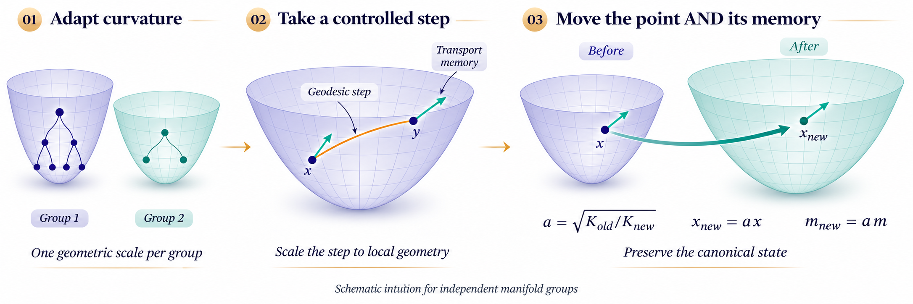

<div align="center">

<h1>HyperbolicMomentum</h1>
<p>曲率自适应流形优化</p>



<sub>可学习曲率 · 测地线更新 · 动量传输</sub>

</div>

## 概述

HyperbolicMomentum 研究具有可学习分组曲率的黎曼优化。曲率变化时，优化器需要同时调整参数点及其动量所在的切空间。方法将曲率归一化的测地线更新，与跨曲率的参数、动量联合映射结合起来。

仓库包含优化器、实验协议与结果、图表复现数据，以及含收敛性和泛化分析的完整论文。

## 方法

每个分组维护 Lorentz 流形上的参数点、切向动量和曲率大小 $K>0$。更新区分当前流形上的运动与几何本身的变化。

| 组成 | 更新方式 |
| :--- | :--- |
| **测地线步长** | 将切向梯度累积为动量，并按曲率与动量大小归一化步长。 |
| **动量传输** | 用指数映射更新参数，将动量平行传输至新的基点。 |
| **曲率适应** | 在固定规范坐标下计算曲率全导数，以较慢时间尺度更新曲率，再联合映射参数与动量。 |

归一化步长与跨曲率映射为

$$
\eta_{\mathrm{geo}}=\frac{\eta}{1+\gamma\sqrt{K}\lVert\widetilde m\rVert_x},
\qquad
(x,m)\mapsto(a x,a m),
\quad a=\sqrt{\frac{K_{\mathrm{old}}}{K_{\mathrm{new}}}}.
$$

联合映射在精确算术下保持规范状态 $(\sqrt{K}x,\sqrt{K}m)$ 不变；实现中在映射后修正数值切向误差。这一解释适用于各分组拥有独立流形的架构，共享实体模型在论文中单独讨论。

## 快速开始

使用 Python **3.11** 和 PyTorch **2.5**。几何检查和小型合成验证可在 CPU 上运行，完整实验使用 CUDA。

```bash
git clone https://github.com/Hik289/manifold-hyperbolic-optimization.git
cd manifold-hyperbolic-optimization
python3.11 -m venv .venv
source .venv/bin/activate
python -m pip install -r requirements.txt
```

验证实现并检查仓库内的结果记录：

```bash
python experiments/revision/validate_geometry.py
python scripts/run_experiment.py --smoke --device cpu
python scripts/summarize_results.py
```

小型验证无需下载数据，输出位于 `artifacts/reproduction/runs/fixture_mechanism_B5/`，带有 `fixture_only` 标记，不计入正式实验。所有命令均在仓库根目录执行。

## 实验

安装实验依赖，查看注册配置并启动指定实验：

```bash
python -m pip install -r requirements-full.txt
python scripts/run_experiment.py --list --family mechanism
python scripts/run_experiment.py \
  --id mechanism_smooth8_independent_lorentz_3_B5 \
  --device cuda --work-dir artifacts/mechanism
```

通过 `--data-root data` 或 `MANIFOLD_DATA` 指定数据目录。启动器保留配置清单中的训练预算、随机种子、数据划分和选参规则。

实验覆盖合成层级结构、平稳与漂移度量、节点分类、文本、视觉、持续学习、知识图谱、推荐、分类层级、链接预测和检索。数据准备、基线、消融及评估流程见[实验指南](docs/EXPERIMENTS.md)，实验环境见 [`requirements-reproduction.txt`](requirements-reproduction.txt)。原始探索性实现保留在 `experiments/` 中，使用各自的协议。

<details>
<summary><strong>批量运行与输出管理</strong></summary>

按顺序运行一个任务族中保留的配置：

```bash
python scripts/run_experiment.py \
  --all-retained --family mechanism --device cuda
```

已完成的运行会被复用。已有未完成轨迹时，应选择新的工作目录，避免混合运行。延期配置可以通过 `--id` 启动，其新结果与已发布的完成记录分开保存。

</details>

## 论文与图表复现

从仓库内的数据重新生成 loss 曲线与比较表：

```bash
python paper/scripts/reproduce_figures.py
python paper/scripts/reproduce_positive_tables.py
```

这两项无需训练、GPU 或网络。绘图脚本检查输入哈希并导出 **PNG 和 PDF**；使用[记录的绘图环境](paper/scripts/requirements-figures.txt)可匹配已发布的渲染。方法示意图另附[生成说明](assets/intuition_readme_prompt.txt)。

<details>
<summary><strong>本地编译与 Overleaf</strong></summary>

安装 TeX Live 和 `latexmk` 后执行：

```bash
python paper/scripts/build_paper.py
```

上传 `paper/` 内容到 Overleaf，将 `main.tex` 设为主文件，编译器选择 **pdfLaTeX**。当前使用基于 ICML 2026 的本地 ICML 2027 草稿封装，[模板来源说明](paper/TEMPLATE_PROVENANCE.txt)记录其来源与状态。

</details>

## 仓库内容

全部实验源码、注册配置、已完成结果和论文绘图输入均包含在仓库中。数据集、模型权重和训练日志保存在本地。[发布说明](docs/RELEASE.md)介绍源码覆盖范围及可移植性调整。
